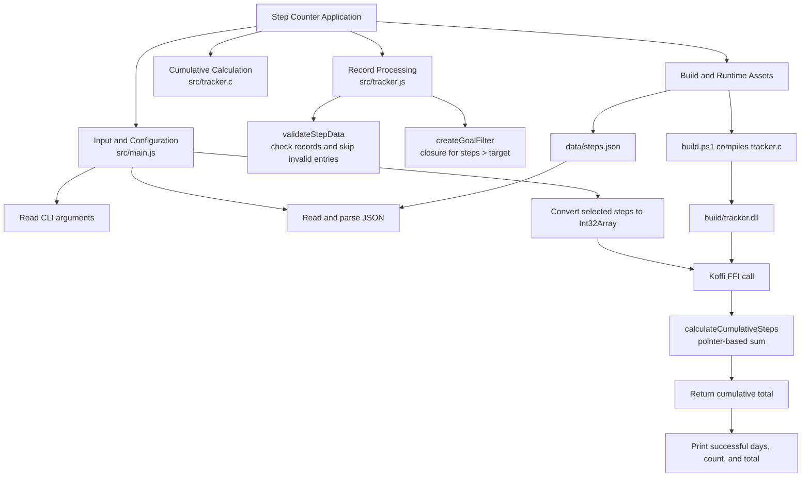
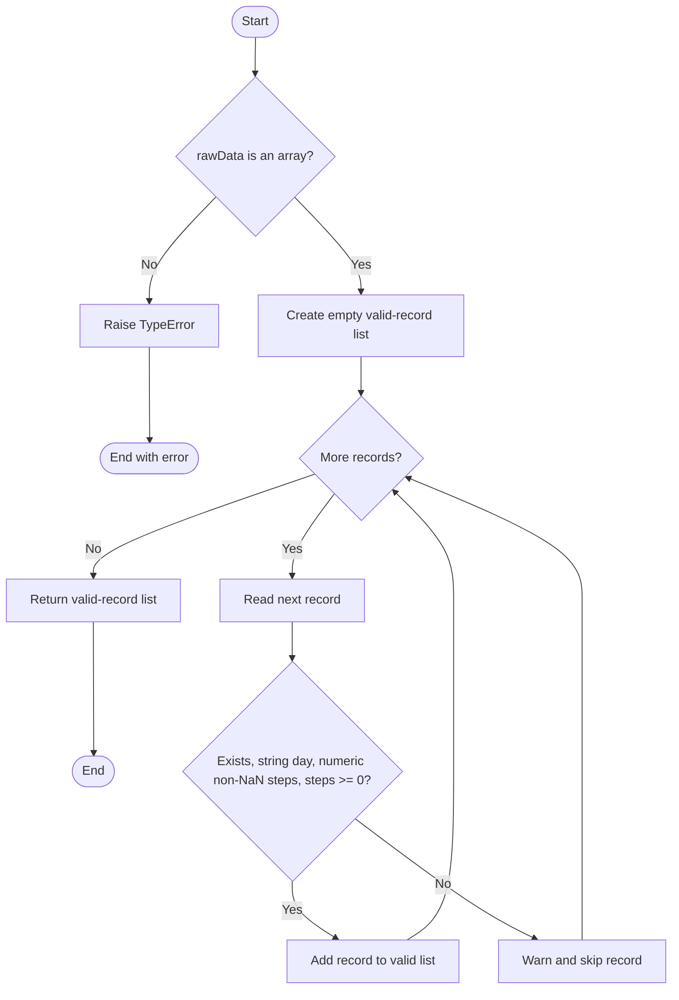
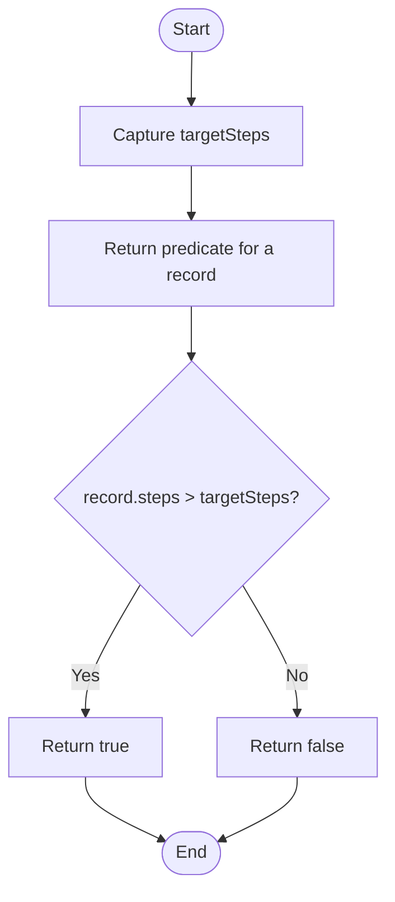
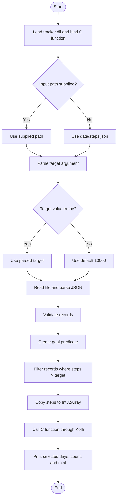
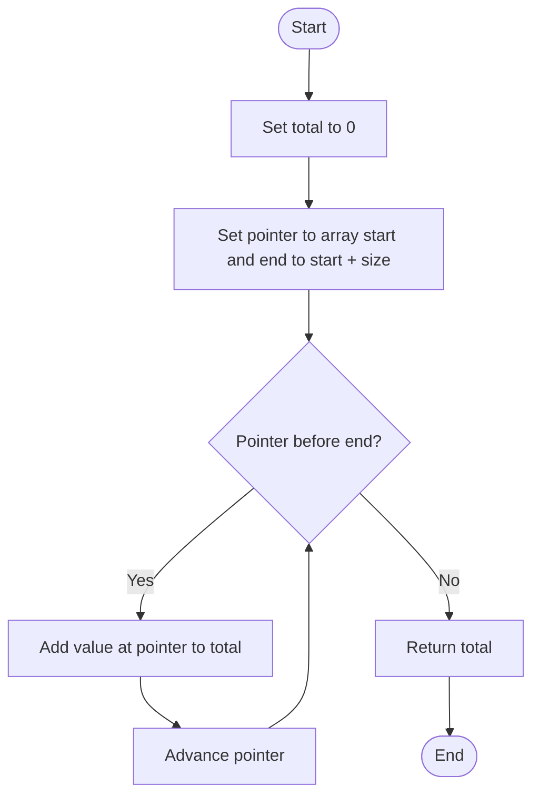
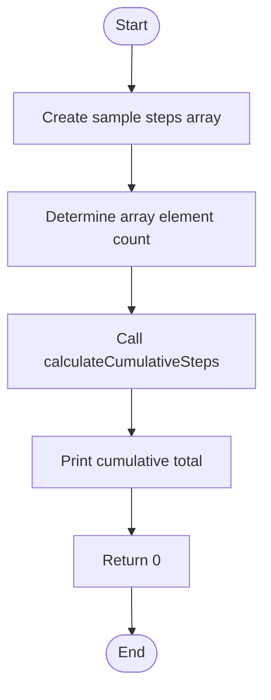

# Fitness Goal Achievement and Cumulative Activity Tracker

## Coursework Report

**Course:** CPE 317 — Computer Programming Coursework  
**Project option:** 7 — Fitness Goal Achievement and Cumulative Activity Tracker  
**Academic year:** 2026/2027  
**Submission date:** 18 November 2026  
**Student matric number:** 24/ENG09/030

---

## 1. Abstract

This project is a command-line program that reads daily step records from a JSON file, checks each record, selects days whose step count is strictly greater than a user-selected goal, and calculates the total steps for those selected days. JavaScript (Node.js ES modules) handles file input, validation, filtering, and output. A compiled C dynamic-link library (DLL) receives the filtered integer array through the Koffi foreign-function interface (FFI) and calculates its sum using pointer traversal.

## 2. Aim and Learning Outcomes

The aim is to demonstrate sequence control, parameter passing, relational and logical operators, a closure-based function factory, arrays and pointers in C, and a JavaScript-to-C function call. The project demonstrates these through JSON record processing, `createGoalFilter(targetSteps)`, validation conditions, an `Int32Array`, and `calculateCumulativeSteps`.

## 3. Requirements and Scope

The program accepts daily records with a string `day` and a non-negative numeric `steps` value. It removes malformed records with a warning, filters valid records using a strict greater-than comparison, and calculates the cumulative steps for the successful days. The default input is `data/steps.json` and the default goal is 10,000 steps. An alternate JSON path and goal can be provided as command-line arguments.

The current interface is a terminal/command-line interface. The C DLL is built for Windows x64 using Microsoft Visual C++ Build Tools. This report describes the implementation in the submitted source files; it does not include full source code.

## 4. Top-Down Design



### 4.1 Processing Sequence

1. The build script compiles the C source into `build/tracker.dll`.
2. The JavaScript entry point loads the DLL and binds the C function signature through Koffi.
3. The entry point selects the input JSON path and step goal from command-line arguments or defaults.
4. The JSON records are parsed and passed to the validator.
5. The closure-produced predicate selects records for which `steps > targetSteps`.
6. The selected values are copied into an `Int32Array` and passed to C.
7. The C function traverses the array with a pointer and returns the sum.
8. JavaScript displays the selected days, selected-day count, and cumulative result.

## 5. Contribution Table

The available project documentation identifies one contributor. Matric numbers are shown only in the member column, as required. No subgroup participation is recorded in the supplied project files.

| Member matric number | Function, module, or responsibility | Language / technology | Subgroup |
|---|---|---|---|
| 24/ENG09/030 | `validateStepData(rawData)` in `src/tracker.js`: record schema checks and invalid-record warnings | JavaScript | Individual |
| 24/ENG09/030 | `createGoalFilter(targetSteps)` in `src/tracker.js`: closure factory returning the goal predicate | JavaScript | Individual |
| 24/ENG09/030 | Main pipeline in `src/main.js`: CLI options, JSON input, validation and filtering, FFI call, output | JavaScript, Node.js, Koffi | Individual |
| 24/ENG09/030 | `calculateCumulativeSteps(stepsArray, size)` in `src/tracker.c`: pointer-based array sum exported for FFI | C | Individual |
| 24/ENG09/030 | `main()` in `src/tracker.c`: standalone demonstration of the C calculation | C | Individual |
| 24/ENG09/030 | Build script `build.ps1` and project setup | PowerShell, MSVC | Individual |
| 24/ENG09/030 | Report writing and documentation | Markdown | Individual |

## 6. Detailed Logic Documentation

### 6.1 `validateStepData(rawData)` — JavaScript

**Assigned matric number:** 24/ENG09/030  
**Purpose:** Ensure the input is an array and retain only records with a string day and a numeric, non-NaN, non-negative step count. Invalid records are warned about and skipped. A non-array input raises a `TypeError`.

#### Pseudocode

```text
FUNCTION validateStepData(rawData)
  IF rawData is not an array
    Raise TypeError
  END IF

  Create an output list
  FOR EACH item in rawData
    valid = item exists
            AND item.day is a string
            AND item.steps is a number
            AND item.steps is not NaN
            AND item.steps >= 0
    IF valid
      Add item to output list
    ELSE
      Print validation warning and skip item
    END IF
  END FOR
  RETURN output list
END FUNCTION
```

#### Flowchart



### 6.2 `createGoalFilter(targetSteps)` — JavaScript

**Assigned matric number:** 24/ENG09/030  
**Purpose:** Return a predicate function that captures the supplied target in its lexical scope. The predicate returns true only when a record's step count is strictly greater than the target. A record equal to the goal does not pass.

#### Pseudocode

```text
FUNCTION createGoalFilter(targetSteps)
  RETURN FUNCTION(record)
    RETURN record.steps > targetSteps
  END FUNCTION
END FUNCTION
```

#### Flowchart



### 6.3 Main pipeline — `src/main.js`

**Assigned matric number:** 24/ENG09/030  
**Purpose:** Coordinate the input, validation, filtering, FFI call, and reporting. If the second CLI argument is missing, zero, or not a usable number, the current implementation falls back to 10,000 because it uses `Number(argument) || 10000`.

#### Pseudocode

```text
START main module
  Construct path to build/tracker.dll
  Load DLL using Koffi
  Bind calculateCumulativeSteps C function signature

  Read input path from first CLI argument
  IF path is missing, use data/steps.json
  Read target from second CLI argument as a number
  IF target is falsy, use 10000

  Read selected file and parse JSON
  cleanData = validateStepData(parsed JSON)
  predicate = createGoalFilter(target)
  successfulDays = records in cleanData accepted by predicate
  Copy successful step counts into an Int32Array
  total = call C function with array and array length

  Print target, successful days, count, and total
END main module
```

#### Flowchart



### 6.4 `calculateCumulativeSteps(stepsArray, size)` — C

**Assigned matric number:** 24/ENG09/030  
**Purpose:** Sum the integer array using a pointer from its first element up to, but not including, the end pointer. It returns a `long long` cumulative total.

#### Pseudocode

```text
FUNCTION calculateCumulativeSteps(stepsArray, size)
  total = 0
  pointer = address of first array element
  end = pointer + size
  WHILE pointer is before end
    total = total + value at pointer
    Advance pointer by one integer
  END WHILE
  RETURN total
END FUNCTION
```

#### Flowchart



### 6.5 Standalone C `main()` — `src/tracker.c`

**Assigned matric number:** 24/ENG09/030  
**Purpose:** Demonstrate the C calculation independently with a fixed sample array. The normal JavaScript application calls the exported calculation in the DLL; this standalone entry point is a separate demonstration.

#### Pseudocode

```text
FUNCTION main()
  Create sample array [12450, 15200, 10000, 11200]
  Determine number of elements
  total = calculateCumulativeSteps(sample array, element count)
  Print total
  RETURN 0
END FUNCTION
```

#### Flowchart



## 7. Implementation and Data

| Path | Description |
|---|---|
| `src/main.js` | Node.js entry point and JavaScript-to-C integration |
| `src/tracker.js` | Validation and closure-based goal filter |
| `src/tracker.c` | Exported pointer-based cumulative calculator and standalone demo |
| `data/steps.json` | Sample daily records, including one intentionally malformed record |
| `build.ps1` | Locates the MSVC x64 toolchain and builds the DLL |
| `build/tracker.dll` | Compiled C library loaded by the JavaScript program |
| `package.json` | ES module configuration, Koffi dependency, and npm scripts |

The bundled dataset contains records for Monday through Sunday. Wednesday has a string value (`"invalid_data"`) in the `steps` field and is intentionally rejected by validation. The input data is a project-authored sample dataset stored in `data/steps.json`; it is not presented as measured or externally sourced personal activity data.

## 8. Build, Run, and Test Instructions

### 8.1 Prerequisites

- Windows x64
- Node.js (the project README records testing with Node.js v24.19.0)
- Microsoft Visual Studio or Build Tools with the MSVC x64 C/C++ toolset, including `cl.exe` and `vswhere.exe`

### 8.2 Installation and Build

Open PowerShell in the project folder and install dependencies:

```powershell
npm install
```

Build the C DLL:

```powershell
npm run build
```

Build and run in one command using the default dataset and goal:

```powershell
npm run dev
```

### 8.3 Custom Input and Goal

The first argument is the JSON file path. The second argument is the goal. For example:

```powershell
npm start -- data/steps.json 8000
```

The filter uses `steps > goal`, not `steps >= goal`. Ensure the DLL has been built before running `npm start` directly.

### 8.4 Test Scenarios

| Scenario | Test data / command | Expected behavior and result |
|---|---|---|
| 1. Valid numeric records, default goal | `npm run dev` with bundled `data/steps.json`; goal 10,000 | Wednesday is skipped with a validation warning. Monday (12,450), Thursday (15,200), and Sunday (11,200) pass. Count = 3; cumulative total = **38,850**. Friday has exactly 10,000 and is excluded because comparison is strict. |
| 2. Different numeric goal | `npm start -- data/steps.json 8000` after building | Tuesday (8,300), Monday (12,450), Thursday (15,200), Friday (10,000), and Sunday (11,200) pass. Count = 5; cumulative total = **57,150**. Wednesday remains skipped. |
| 3. Invalid record input | Bundled JSON includes `{ "day": "Wednesday", "steps": "invalid_data" }` | The malformed record is rejected and a validation warning is printed. It is not passed to C; valid records continue through filtering and summation. A non-array top-level JSON value raises a `TypeError` in `validateStepData`. |

The first two expected results are also recorded in the project README. Scenario 3 describes the invalid-record behavior implemented in `src/tracker.js`.

## 9. Results and Limitations

The project combines JavaScript record processing with a C calculation through an FFI call. Validation prevents malformed and negative step values from reaching the C function, while the closure allows the goal predicate to be configured per run.

The CLI currently defaults a goal of zero to 10,000 because of the `Number(...) || 10000` expression. The C interface accepts `int` elements in the `Int32Array`; extremely large or fractional numeric step values are not explicitly constrained to the integer range before conversion. The provided test data uses ordinary whole-number step counts.

The project inventory records five distinct functions/modules (including the standalone C demonstration), which meets the minimum of five only for a group of up to five members. The supplied files document one matric number; verify that the contribution list and module count reflect the actual group roster before submission if additional members participated.

## 10. References

1. Koffi project documentation, used for the JavaScript foreign-function interface and native library binding: [https://koffi.dev/](https://koffi.dev/).
2. Node.js documentation, used for Node.js runtime and file system APIs: [https://nodejs.org/docs/latest/api/](https://nodejs.org/docs/latest/api/).
3. Microsoft Learn, MSVC compiler documentation: [https://learn.microsoft.com/en-us/cpp/build/reference/compiling-a-c-cpp-program](https://learn.microsoft.com/en-us/cpp/build/reference/compiling-a-c-cpp-program).

## 11. Submission Note

Submit this Markdown report as the soft copy together with the implementation files in the required zipped project folder. Export this report to PDF for the hardcopy submission. The assignment brief states that the hardcopy need not include program source code.
