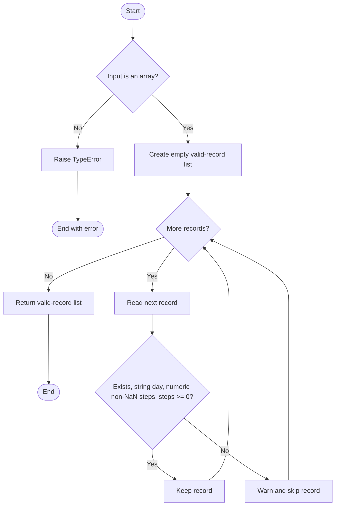
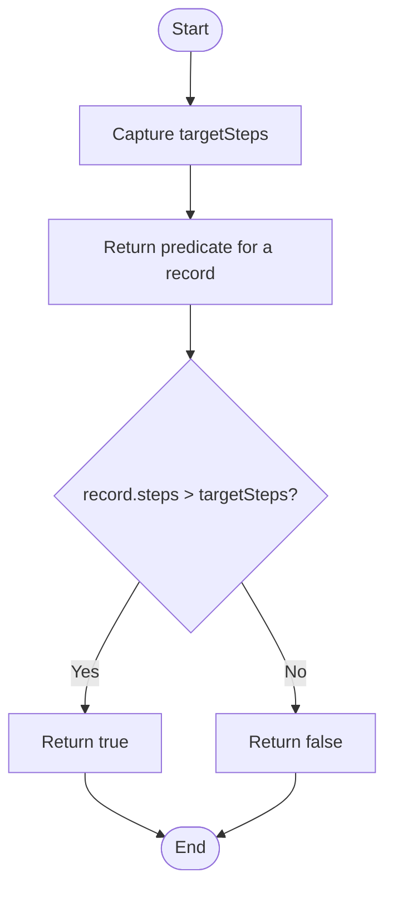
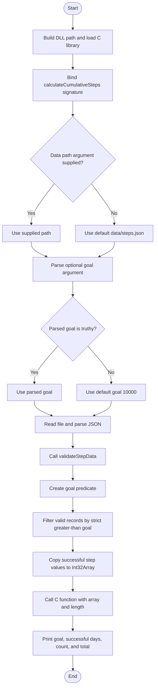
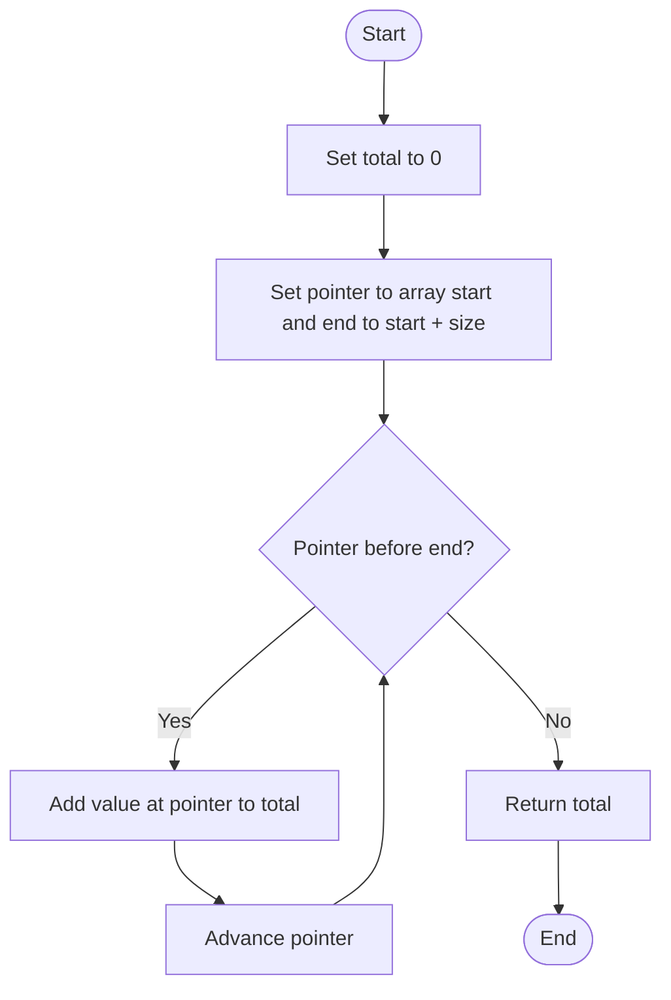
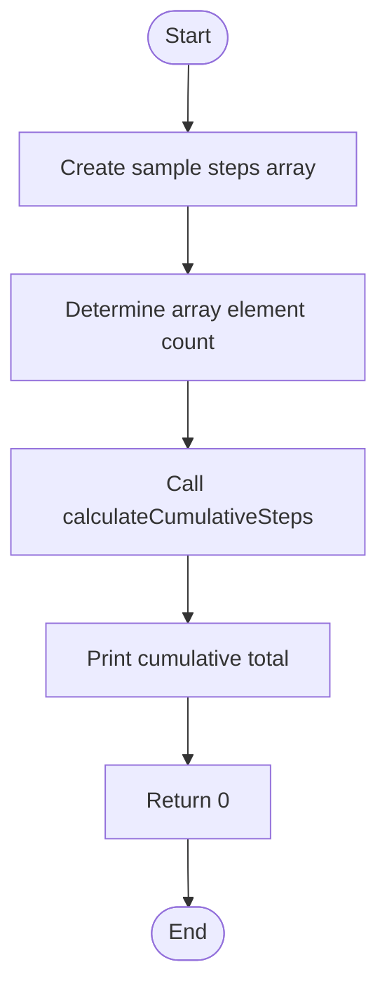

# Step Counter Project Flowcharts

**Assignment:** All functions and modules in this report are assigned to **Harry Eliki** (24/ENG09/030).

## 1. `validateStepData(rawData)` — Harry Eliki

## 2. `createGoalFilter(targetSteps)` — Harry Eliki

## 3. `src/main.js` main pipeline — Harry Eliki

## 4. `calculateCumulativeSteps(stepsArray, size)` — Harry Eliki

## 5. `main()` standalone C demo — Harry Eliki

